<div align="center">


<br/>


<br/><br/>

<a href="#about"></a>
<a href="#education"></a>
<a href="#skills"></a>
<a href="#learning"></a>
<a href="#projects"></a>
<a href="#roadmap"></a>
<a href="#stats"></a>
<a href="#contact"></a>

<br/>


</div>


<a id="about"></a>

<div align="center">

## 👨‍💻 About Me

*Passionate about building intelligent solutions through AI and technology.*

</div>

Hello! I'm **Vikas Kashyap**, an MCA student specializing in **Artificial Intelligence & Machine Learning** at **IIMT University, Meerut**. I am passionate about Artificial Intelligence, Machine Learning, Deep Learning and developing intelligent real-world applications.

```python
class VikasKashyap:
    role        = "Aspiring AI/ML Engineer | Python Developer"
    studying    = "MCA – Artificial Intelligence & Machine Learning @ IIMT University, Meerut"
    interests   = ["Machine Learning", "Deep Learning", "NLP", "Computer Vision"]
    architectures = ["ANN", "CNN", "RNN", "Transformers"]
    data_skills = ["Data Analysis", "Data Visualization"]
    goal        = "AI/ML Engineer"
    motto       = "Learning Today, Building Tomorrow!"

    def ask_me_about(self):
        return ["Python", "Machine Learning", "Deep Learning", "NLP", "Computer Vision"]
```


<a id="education"></a>

<div align="center">

## 🎓 Education

*Academic background*

<table>
<tr>
<td align="center" width="25%">
<h3>🎓</h3>
<b>MCA – AI & ML</b><br/>
<b>IIMT University</b><br/>
<sub>Meerut</sub><br/><br/>

</td>
<td align="center" width="25%">
<h3>💻</h3>
<b>BCA</b><br/>
<b>CCS University</b><br/>
<sub>2025</sub><br/><br/>

</td>
<td align="center" width="25%">
<h3>📘</h3>
<b>Class 12</b><br/>
<b>UP Board</b><br/>
<sub>Intermediate</sub><br/><br/>

</td>
<td align="center" width="25%">
<h3>📗</h3>
<b>Class 10</b><br/>
<b>UP Board</b><br/>
<sub>High School</sub><br/><br/>

</td>
</tr>
</table>

</div>


<a id="skills"></a>

<div align="center">

## 💻 Technical Skills

*Technologies and tools I use and explore in programming, AI and data science.*

<table>
<tr>
<td align="center" width="50%">
<h3>🐍 Programming Languages</h3>
<br/>
<sub>Python · C · C++ · Java (Basic) · SQL</sub>
</td>
<td align="center" width="50%">
<h3>🤖 AI & Machine Learning</h3>
<br/>


</td>
</tr>
<tr>
<td align="center">
<h3>📊 Data Science & Analytics</h3>
<br/>


</td>
<td align="center">
<h3>🧰 Tools & Environment</h3>
<br/>
<sub>Git · GitHub · Linux · VS Code</sub>
</td>
</tr>
</table>

</div>


<a id="learning"></a>

<div align="center">

## 🚧 Currently Learning & Working On

*Continuously exploring modern AI frameworks, development tools and deployment technologies.*

</div>

| Area | Technology | Learning Focus |
|---|---|---|
| 🧠 **ML & DL Frameworks** |  | Machine Learning Models & Model Evaluation |
| |  | Deep Learning & Neural Networks |
| 👁️ **CV, NLP & GenAI** |  | Image Processing & Computer Vision |
| |  | Pre-trained Models & NLP |
| |   | Transformer Architecture & LLMs |
| 🌐 **App Development & Deployment** |   | AI Model APIs & Backend Development |
| |  | Interactive AI Applications |
| |  | Containerization & Application Deployment |
| 🗄️ **Data & Version Control** |  | Database Design & Management |
| |  | Data Visualization & Interactive Dashboards |
| |  | Version Control & Project Collaboration |

<div align="center">

**📚 Currently Exploring**

`Advanced Deep Learning` · `Generative AI` · `Large Language Models (LLMs)` · `Transformers Architecture` · `Natural Language Processing` · `AI Model Deployment`

</div>


<a id="projects"></a>

<div align="center">

## 🚀 Featured AI/ML Projects

*Exploring practical applications of Artificial Intelligence and Data Science.*

<!-- TIP: Replace every https://github.com/vikas-io link below with that project's real repository URL. -->

<table>
<tr>
<td align="center" width="33%">
<h2>🎬</h2>
<b>Movie Recommendation System</b><br/>
<sub>Personalized movie recommendations</sub><br/><br/>

<br/><br/>
<a href="https://github.com/vikas-io"></a>
</td>
<td align="center" width="33%">
<h2>📚</h2>
<b>Book Recommendation System</b><br/>
<sub>Intelligent book recommendations</sub><br/><br/>

<br/><br/>
<a href="https://github.com/vikas-io"></a>
</td>
<td align="center" width="33%">
<h2>📧</h2>
<b>Spam Email Classifier</b><br/>
<sub>Email spam detection</sub><br/><br/>

<br/><br/>
<a href="https://github.com/vikas-io"></a>
</td>
</tr>
<tr>
<td align="center">
<h2>👁️</h2>
<b>Face Recognition using CNN</b><br/>
<sub>Deep learning-based face recognition</sub><br/><br/>

<br/><br/>
<a href="https://github.com/vikas-io"></a>
</td>
<td align="center">
<h2>📊</h2>
<b>WhatsApp Chat Analyzer</b><br/>
<sub>Chat analysis and visualization</sub><br/><br/>

<br/><br/>
<a href="https://github.com/vikas-io"></a>
</td>
<td align="center">
<h2>✨</h2>
<b>More Projects</b><br/>
<sub>Explore all my repositories and experiments</sub><br/><br/>
<br/><br/>
<a href="https://github.com/vikas-io?tab=repositories"></a>
</td>
</tr>
</table>

</div>


<a id="roadmap"></a>

<div align="center">

## 🎯 AI/ML Career Roadmap

*My step-by-step path towards becoming an AI/ML Engineer.*

```mermaid
flowchart LR
    A["🐍 Foundations<br/>Python · C · C++ · SQL"] --> B["📊 Data Science<br/>NumPy · Pandas"]
    B --> C["🤖 Machine Learning<br/>Scikit-learn"]
    C --> D["🧠 Deep Learning<br/>TensorFlow · PyTorch"]
    D --> E["👁️ NLP · CV · GenAI<br/>OpenCV · HF · LLMs"]
    E --> F["🌐 Deployment<br/>Flask · FastAPI · Docker"]
    F --> G["🎯 AI/ML Engineer"]

    classDef done fill:#0B1F42,stroke:#38BDF8,color:#ffffff
    classDef progress fill:#1646A0,stroke:#38BDF8,color:#ffffff
    classDef goal fill:#22C55E,stroke:#ffffff,color:#ffffff
    class A,B done
    class C,D,E,F progress
    class G goal
```

</div>



| Stage | Focus | Status |
|---|---|---|
| **1. Foundations** | Python, C, C++, SQL, Git & GitHub | ✅ Completed |
| **2. Data Science** | NumPy, Pandas, Matplotlib, Data Analysis & Visualization | ✅ Completed |
| **3. Machine Learning** | Scikit-learn, Model Building & Evaluation | 🔄 In Progress |
| **4. Deep Learning** | ANN, CNN, RNN with TensorFlow & PyTorch | 🔄 In Progress |
| **5. NLP, CV & GenAI** | OpenCV, Hugging Face, Transformers, LLMs | 🔄 Exploring |
| **6. Deployment** | Flask / FastAPI, Streamlit, Docker | 📘 Learning |
| **7. Career Goal** | AI/ML Engineer, building real-world AI products | 🎯 Target |

<!-- Edit the Status column and the "class" lines in the diagram to match your real progress. -->


<a id="stats"></a>

<div align="center">

## 📈 GitHub Statistics

*My coding activity, repository language distribution and GitHub profile overview.*

<br/>


<br/><br/>


<br/>

### 🔥 Contribution Streak


### 🏆 GitHub Trophies


### 📅 Contribution Activity


### 🐍 Contribution Snake


</div>


<a id="contact"></a>

<div align="center">

## 📫 Connect With Me

*Let's connect, share knowledge and build something amazing together!*

<br/>

<a href="mailto:vs3725725@gmail.com"></a>
<a href="https://wa.me/917078124610"></a>
<a href="tel:+917078124610"></a>
<a href="https://github.com/vikas-io"></a>

<!-- Add LinkedIn (recommended), then remove this comment:
<a href="https://www.linkedin.com/in/YOUR-ID"></a>
-->

<br/><br/>

## 💡 My Mission

### "Learning Today, Building Tomorrow!"

**Turning ideas into intelligent solutions with AI & Machine Learning.**

<br/>


<br/><br/>


### 💙 Keep Learning | Keep Building | Keep Growing


</div>
